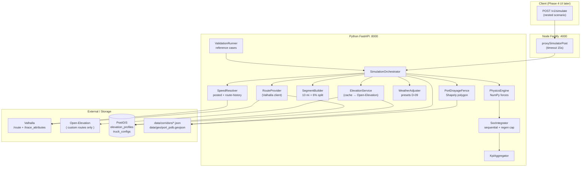

# Phase 2: Physics Simulation Core - Research

**Researched:** 2026-07-01
**Domain:** NumPy segment physics, Valhalla truck routing, elevation/grade integration, sync FastAPI simulate API
**Confidence:** HIGH

## Summary

Phase 2 implements the simulation brain on top of Phase 1 spatial assets: Valhalla Class 8 routes, cached elevation profiles, and seeded truck configs. The locked architecture is a **synchronous `POST /v1/simulate`** on FastAPI (D-01) proxied by Fastify (D-02), returning **full segment arrays** (D-04) without charging logic or Celery (deferred Phase 3). Physics uses **10 US mile (~16,093 m) segments** (D-05) with **|grade| > 6% subdivision** (D-07), NumPy-vectorized force balance per Technical Architecture §3.3, and sequential SoC integration for regen caps.

The orchestration pipeline is: resolve route (preset corridor or custom O/D) → fetch grades (cache-first by `corridor_key`, Open-Elevation fallback for custom routes per D-06) → build physics segments → assign speeds (Valhalla `trace_attributes` for posted limits + route-history overlay per D-08) → apply weather presets (D-09) and geo-fenced port drayage (D-10) → run PhysicsEngine → aggregate KPIs. Performance stays under **10s p95** (ROUT-04) by avoiding live elevation on preset corridors, batching Open-Elevation when needed, and keeping segment counts low (~15–40 segments for SoCal corridors vs hundreds at 150 m resolution).

Validation gates two reference cases at **±8–12% MAPE** (D-11): flat highway OEM ideal range and POLB→Cajon with grade, exposed via **`GET /v1/physics/validation`** and pytest CI (D-12). Pitfalls research (PITFALLS.md) mandates usable kWh (not nameplate), SOC-capped regen, temperature-dependent aux, and conservative OEM-vs-grade interpretation — all directly applicable.

**Primary recommendation:** Implement `SimulationOrchestrator` in `services/simulator/app/` as a pure-Python pipeline module; expose thin FastAPI routes; extend Valhalla client with a second `trace_attributes` call for edge speeds; reuse `data/ingest/elevation.py` sampling/filter patterns for live fallback; add NumPy/SciPy to `requirements.txt`; wire Fastify POST proxy with **15s timeout** (not 5s GET default).

<user_constraints>
## User Constraints (from CONTEXT.md)

### Locked Decisions

#### Simulation API & Invocation
- **D-01:** Phase 2 uses **synchronous `POST /v1/simulate`** on FastAPI — single response with full result; target **<10s p95** per ROUT-04; Celery/async job pipeline deferred to Phase 3 (PLAT-02)
- **D-02:** **Fastify proxies `/v1/simulate`** on `:4000` — same pattern as routing, trucks, elevation (orchestrator discretion per user "you decide")
- **D-03:** Request body uses a **nested scenario object**: `route{}`, `truck{}`, `conditions{}`, `overrides{}` — maps cleanly to Phase 4 analyst form (orchestrator discretion)
- **D-04:** Response **always includes full segment arrays** — every segment returns `dist_m`, `grade`, `speed`, `energy_kwh`, `soc_pct` (and related fields) for Phase 4 charting

#### Route Segmentation & Elevation
- **D-05:** Physics segments use **10 US mile** discretization (~16,093 m) — user preference over metric 150m/500m defaults
- **D-06:** Elevation/grade sourcing: **cached corridor profiles first** (`elevation_profiles` for preset corridors), **live Open-Elevation fallback** for custom origin/destination pairs
- **D-07:** Within 10-mile segments, **subdivide when |grade| > 6%** to preserve Cajon Pass fidelity without abandoning mile-based segmentation (orchestrator discretion per user "you decide")
- **D-08:** Segment speed: **posted speed limits from Valhalla edge metadata** where available, capped for Class 8 truck costing; apply an **overlay of route history as the simulation builds** — accumulated prior-segment context adjusts effective speed along the route (user-specified overlay on top of posted limits)

#### Weather & Port Drayage
- **D-09:** Weather presets follow **PRD-style definitions**: Ideal (20°C, 0 headwind); Hot (35°C + thermal derate); Cold (0°C + heater aux bump); Headwind (15 mph headwind + aero penalty)
- **D-10:** Port drayage profile (PHYS-07) applies inside a **geo-fenced port polygon** (POLB/Long Beach port boundary) — stop-go penalty, elevated aux kW, lower speed cap; does not blanket the entire route

#### OEM Validation (PHYS-06)
- **D-11:** Two reference test cases gate validation: **(1) flat highway ideal OEM range**, **(2) POLB→Cajon with grade** — both must pass **±8–12% MAPE**
- **D-12:** Validation exposed via **`GET /v1/physics/validation`** (MAPE per case + pass/fail) **and** pytest CI gate

#### Corridor Presets & Physics Overrides
- **D-13:** Corridor/terminal presets (ROUT-02) stored as **JSON fixtures** (`data/corridors/*.json`) with **`GET /v1/corridors`** listing presets; ties to existing elevation cache `corridor_key` values
- **D-14:** Truck physics overrides (PHYS-08): **inline on simulate request** with **`assumptions[]` audit trail** in response; omitting overrides = OEM defaults; support explicit reset-to-OEM semantics in API contract

### Claude's Discretion
- Exact nested request field names and OpenAPI schema shape for `/v1/simulate`
- Route-history speed overlay implementation detail (rolling average vs cumulative time/distance heuristic) — must be documented in `model_assumptions.md`
- Port polygon GeoJSON source and boundary definition file location
- Flat-highway OEM reference case constants (distance, payload, speed) sourced from public eCascadia/T680E specs
- NumPy vectorization structure and segment loop vs batch arrays

### Deferred Ideas (OUT OF SCOPE)
- **Charging stop recommendations** — Phase 3 (CHRG-*)
- **Celery job pipeline / async poll** — Phase 3 (PLAT-02)
- **NHFN route preference** — Phase 5 (ROUT-03)
- **Saved override profiles in DB** — deferred; inline overrides sufficient for Phase 2
- **Analyst map/SoC visualization** — Phase 4 (MAP-*)
- **Tiered response detail (`?detail=summary`)** — user chose full segments always; summary-only mode not needed in Phase 2
</user_constraints>

<phase_requirements>
## Phase Requirements

| ID | Description | Research Support |
|----|-------------|------------------|
| PHYS-01 | Input O/D, truck, payload, conditions → run simulation | Nested `scenario` request (D-03); `POST /v1/simulate` sync API (D-01); corridor presets + custom O/D (D-13) |
| PHYS-02 | Segment energy: rolling + aero + grade + aux − regen (NumPy) | PhysicsEngine vectorized force arrays + §3.3 equations; `numpy==2.5.0` stack |
| PHYS-03 | Elevation integration; Cajon grade impact visible | Cache-first `elevation_profiles` (D-06); 6% grade subdivision (D-07); `polb_cajon_pass` fixture |
| PHYS-04 | Weather presets affect consumption | D-09 preset table: thermal derate, aux bump, headwind aero |
| PHYS-05 | Forward SoC profile + KPIs | Sequential SoC integration; response segment arrays (D-04); KPI aggregator module |
| PHYS-06 | ±8–12% MAPE on reference cases | D-11 two-case gate; `GET /v1/physics/validation` (D-12) |
| PHYS-07 | Port drayage profile in POLB basin | Geo-fenced polygon (D-10); Shapely point-in-polygon on segment midpoints |
| PHYS-08 | Override truck params + assumptions audit | Inline `overrides{}` with reset-to-OEM (D-14); Pydantic bounds validation |
| ROUT-01 | Class 8 Valhalla routes | Extend `routing.py` truck costing; internal reuse in orchestrator |
| ROUT-02 | POLB terminal + corridor presets | `data/corridors/*.json` + `GET /v1/corridors` (D-13) |
| ROUT-04 | <10s p95 simulation | Cache-first elevation; coarse 10-mile segments; sync in-process compute; performance test marker |
</phase_requirements>

## Architectural Responsibility Map

| Capability | Primary Tier | Secondary Tier | Rationale |
|------------|-------------|----------------|-----------|
| `POST /v1/simulate` contract | API / Backend (Python FastAPI) | Node Fastify proxy | Physics and spatial orchestration belong in simulator service per hybrid architecture |
| Fastify `/v1/simulate` proxy | API / Backend (Node) | — | Thin pass-through with extended timeout; no physics in Node (STACK constraint) |
| Valhalla route geometry | External routing (Valhalla container) | Python RouteProvider adapter | Truck costing already in `routing.py`; orchestrator calls adapter |
| Posted speed limits | External routing (Valhalla `trace_attributes`) | Python speed resolver | Per-edge limits not in default `/route` payload [CITED: valhalla.github.io map-matching api-reference] |
| Elevation / grade profiles | Database / Storage (PostGIS cache) | Python ElevationService | D-06 cache-first; live Open-Elevation only on cache miss |
| Physics segmentation (10 mi + 6% split) | API / Backend (Python) | — | Pure computation on route + elevation arrays |
| NumPy force/energy batch | API / Backend (Python) | — | Scientific stack constraint; not in browser or Node |
| SoC forward integration + regen caps | API / Backend (Python) | — | Sequential state; cannot fully vectorize due to SOC-dependent regen |
| Weather preset application | API / Backend (Python) | — | Modifies ρ, thermal efficiency, aux before segment loop |
| Port drayage geo-fence | API / Backend (Python) | Static GeoJSON asset | Shapely/GeoPandas point-in-polygon; polygon file in `data/` |
| Corridor preset listing | API / Backend (Python) | JSON fixtures | Read-only catalog; no DB table required Phase 2 |
| OEM validation endpoint | API / Backend (Python) | pytest CI | Deterministic reference scenarios; no UI Phase 2 |
| OpenAPI / shared types | Python sim service | packages/shared-types | D-02 pattern from Phase 1 |
| Route-history speed overlay | API / Backend (Python) | — | Applied during forward segment loop; documented in `model_assumptions.md` |

## Standard Stack

### Core

| Library | Version | Purpose | Why Standard |
|---------|---------|---------|--------------|
| **NumPy** | 2.5.0 | Vectorized segment force/energy arrays | STACK.md floor; Python 3.12+ required [VERIFIED: PyPI `pip index versions`] |
| **SciPy** | 1.18.0 | Grade interpolation, optional optimize hooks | Paired with NumPy 2.5 per STACK.md [VERIFIED: PyPI] |
| **FastAPI** | 0.138.2 | `/v1/simulate`, `/v1/physics/validation`, `/v1/corridors` | Already in `requirements.txt`; OpenAPI source of truth |
| **Pydantic** | 2.13.4 | Nested scenario request/response models | FastAPI bundle; override bounds validation [VERIFIED: PyPI] |
| **Shapely** | 2.1.x | Port polygon point-in-polygon | Already in requirements; lightweight vs full GeoPandas for fence check |
| **httpx** | ≥0.28 | Valhalla + Open-Elevation HTTP | Existing pattern in `routing.py`, `elevation.py` ingest |
| **SQLAlchemy + psycopg** | 2.0.51 / 3.3.4 | Elevation cache + truck config reads | Phase 1 established |
| **Valhalla** | self-hosted (SoCal tiles) | Truck route + trace_attributes speeds | D-14 graph already built |
| **Fastify** | 5.9.0 | Proxy POST simulate to Python | Phase 1 proxy pattern in `services/api/src/index.ts` |

### Supporting

| Library | Version | Purpose | When to Use |
|---------|---------|---------|-------------|
| **GeoPandas** | 1.1.x | Load port boundary GeoJSON once | Optional if polygon loaded via Shapely JSON directly |
| **pytest** | 8.x | Physics unit + validation CI gate | `@integration` for Valhalla-dependent tests |
| **Alembic** | 1.16.x | Only if new tables needed | Phase 2 likely **no** `simulation_runs` table until Phase 3 |

### Alternatives Considered

| Instead of | Could Use | Tradeoff |
|------------|-----------|----------|
| Custom NumPy segment model | NREL FASTSim embedded | FASTSim is cycle-resolved; fights 10-mile segment architecture and port aux customization (STACK.md) |
| Sync POST simulate | Celery async (Phase 3) | Correct for Phase 2 scope; D-01 locks sync until job pipeline |
| Valhalla `trace_attributes` for speeds | Maneuver average speed from `/route` legs | Maneuvers span multiple speed limits; insufficient for D-08 [CITED: valhalla.github.io] |
| 150 m physics segments (Tech Arch default) | 10 US mile (D-05) | Coarser segments = faster + fewer; grade subdivision (D-07) preserves Cajon fidelity |
| Live Open-Elevation every run | Cache-only | Violates D-06 for custom routes; cache-only blocks ad-hoc O/D |

**Installation (add to `services/simulator/requirements.txt`):**

```bash
pip install "numpy==2.5.0" "scipy==1.18.0"
# Existing: fastapi, sqlalchemy, shapely, httpx, pytest, etc.
```

**Version verification (2026-07-01):**

```bash
python3 -m pip index versions numpy   # 2.5.0
python3 -m pip index versions scipy   # 1.18.0
python3 -m pip index versions pydantic  # 2.13.4
```

## Package Legitimacy Audit

> Seam `package-legitimacy check` returned SUS for PyPI packages in sandbox (missing download metadata). Manual PyPI verification performed.

| Package | Registry | Age | Downloads | Source Repo | Verdict | Disposition |
|---------|----------|-----|-----------|-------------|---------|-------------|
| numpy | PyPI | mature | very high | github.com/numpy/numpy | OK | Approved — STACK.md pinned 2.5.0 |
| scipy | PyPI | mature | very high | github.com/scipy/scipy | OK | Approved — STACK.md pinned 1.18.0 |
| pydantic | PyPI | mature | very high | github.com/pydantic/pydantic | OK | Approved |
| shapely | PyPI | mature | high | github.com/shapely/shapely | OK | Approved |
| geopandas | PyPI | mature | high | github.com/geopandas/geopandas | OK | Approved — optional port polygon load |

**Packages removed due to [SLOP] verdict:** none

**Packages flagged as suspicious [SUS]:** none after manual PyPI verification

## Architecture Patterns

### System Architecture Diagram



### Recommended Project Structure

```
services/simulator/
├── app/
│   ├── main.py                    # register simulate, corridors, validation routers
│   ├── routes/
│   │   ├── simulate.py            # POST /v1/simulate
│   │   ├── corridors.py           # GET /v1/corridors
│   │   ├── validation.py          # GET /v1/physics/validation
│   │   └── routing.py             # extend: internal route + trace_attributes helpers
│   ├── simulation/
│   │   ├── orchestrator.py        # pipeline coordinator
│   │   ├── segment_builder.py     # 10 mi discretization + 6% grade split
│   │   ├── physics_engine.py      # NumPy vectorized forces
│   │   ├── soc_integrator.py      # forward SoC + regen caps
│   │   ├── weather.py             # preset multipliers (D-09)
│   │   ├── port_drayage.py        # geo-fence + aux/speed penalties
│   │   ├── speed_resolver.py      # Valhalla limits + route-history overlay
│   │   ├── elevation_service.py   # cache lookup + live fallback (reuse ingest utils)
│   │   ├── route_provider.py      # Valhalla adapter
│   │   ├── validation_cases.py    # OEM flat + Cajon reference constants
│   │   └── schemas.py             # Pydantic SimulateRequest/Response
│   └── ...
├── tests/
│   ├── test_physics_engine.py     # unit: force balance, regen cap
│   ├── test_segment_builder.py    # 10 mi + 6% split edge cases
│   ├── test_weather_presets.py    # Ideal vs Cold Wh/mi delta
│   ├── test_validation_gate.py    # MAPE ±8–12% (fixture elevation)
│   └── test_simulate_api.py       # TestClient POST /v1/simulate
├── docs/
│   └── model_assumptions.md       # deliverable per roadmap
data/
├── corridors/*.json               # existing presets (D-13)
├── geo/port_polb_lb.geojson       # port boundary (planner discretion)
└── validation/
    └── reference_cases.json       # OEM expected kWh/range constants
services/api/src/index.ts          # add proxySimulatorPost for /v1/simulate
```

### Pattern 1: NumPy Vectorized Forces + Sequential SoC

**What:** Compute rolling, aero, grade, and aux power for all segments as `float64` arrays; integrate SoC sequentially with SOC-dependent regen caps.

**When to use:** Every simulation run (PHYS-02, PHYS-05).

**Example:**

```python
# Source: 01_Technical_Architecture_FleetVolt.md §3.3 + NumPy broadcasting
import numpy as np

G = 9.80665
MPS_PER_MPH = 0.44704

def segment_forces(
    dist_m: np.ndarray,
    grade_pct: np.ndarray,
    speed_mph: np.ndarray,
    mass_kg: float,
    c_rr: float,
    cd: float,
    frontal_area_m2: float,
    rho: float,
    aux_w: np.ndarray,
) -> tuple[np.ndarray, np.ndarray]:
    theta = np.arctan(grade_pct / 100.0)
    v = speed_mph * MPS_PER_MPH
    cos_t, sin_t = np.cos(theta), np.sin(theta)
    f_roll = c_rr * mass_kg * G * cos_t
    f_aero = 0.5 * rho * cd * frontal_area_m2 * v**2
    f_grade = mass_kg * G * sin_t
    f_traction = f_roll + f_aero + f_grade
    p_traction = f_traction * v
    p_aux = aux_w
    # downhill: f_traction < 0 → regen handled in sequential soc_integrator
    return p_traction, p_aux
```

### Pattern 2: Two-Step Valhalla for Geometry + Posted Speeds

**What:** `POST /route` for polyline, then `POST /trace_attributes` with shape and attribute filters for per-edge speed limits.

**When to use:** Every route resolution (ROUT-01, D-08).

**Example:**

```python
# Source: [CITED: valhalla.github.io/valhalla/api/map-matching/api-reference/]
trace_body = {
    "shape": [{"lat": lat, "lon": lon} for lon, lat in coordinates],
    "costing": "truck",
    "costing_options": {"truck": CLASS8_TRUCK_OPTIONS},
    "directions_options": {"units": "miles"},
    "filters": {
        "attributes": [
            "edge.speed_limit",
            "edge.truck_speed",
            "shape_attributes.length",
            "shape_attributes.speed_limit",
        ],
        "action": "include",
    },
}
# Map edge lengths to physics segments by cumulative distance along route
# Cap effective speed: min(posted_mph, truck_top_speed_kph * 0.621371, class8_cap)
```

### Pattern 3: Cache-First Elevation with Live Fallback

**What:** Preset corridors load `elevation_profiles.profile` JSONB by `corridor_key`; custom O/D reuses `data/ingest/elevation.py` live path then optionally upserts cache.

**When to use:** D-06 for all runs.

**Example:**

```python
# Source: services/simulator/app/routes/elevation.py + data/ingest/elevation.py
# 1. If route.corridor_key: SELECT profile FROM elevation_profiles WHERE corridor_key = :key
# 2. Else: fetch_valhalla_route → sample_polyline → fetch_elevations_batch → filter_bridge_spikes
# 3. Grade at segment boundary: (elev_end - elev_start) / dist_m * 100
# 4. Subdivide 10-mile segment if any sub-interval |grade| > 6% (D-07)
```

### Pattern 4: Sync FastAPI POST with Explicit Timeout

**What:** Single request/response; no job ID. Fastify proxy uses 15s abort; Python orchestrator targets <8s typical.

**When to use:** D-01 Phase 2 only.

**Example:**

```python
# Source: [CITED: fastapi.tiangolo.com] — standard APIRoute; keep handler sync or async with CPU work in thread pool if needed
@router.post("/v1/simulate", response_model=SimulateResponse)
def simulate(request: SimulateRequest, db: Session = Depends(get_db)) -> SimulateResponse:
    return run_simulation(db, request)
```

### Pattern 5: Route-History Speed Overlay (Recommended Discretion)

**What:** As simulation advances segment-by-segment, maintain cumulative distance-weighted average of **realized** segment speeds; blend with posted limit for next segment.

**When to use:** D-08; document in `model_assumptions.md`.

**Recommended formula:**

```
overlay_factor = clamp(0.85, 1.0, prior_avg_speed_mph / prior_posted_avg_mph)
effective_speed = min(posted_speed * overlay_factor, truck_speed_cap, port_cap_if_inside)
```

First segment uses posted limit only (no history).

### Anti-Patterns to Avoid

- **Using nameplate kWh for SoC:** Use `usable_kwh` from truck config (PITFALLS #2).
- **Flat regen on all downhill segments:** Cap/disable above SOC threshold (PITFALLS #4).
- **Constant aux for all weather presets:** Cold/Hot must change aux/BTMS (PITFALLS #3, D-09).
- **Port drayage as whole-route toggle:** Must be polygon-gated (D-10).
- **150 m physics segments on 80+ mile routes:** Violates D-05 and ROUT-04 budget.
- **Celery for Phase 2 simulate:** Deferred explicitly (D-01).
- **Physics in Node/Fastify:** Violates hybrid stack constraint.

## Don't Hand-Roll

| Problem | Don't Build | Use Instead | Why |
|---------|-------------|-------------|-----|
| Road load equations | Custom scalar loop per segment | NumPy vectorized arrays | 10–100× faster; STACK.md mandates Python scientific stack |
| Truck route geometry | Haversine straight line | Valhalla `costing: truck` | Class 8 restrictions, POLB connector realism (PITFALLS #8) |
| Posted speed lookup | Assume 55 mph highway | Valhalla `trace_attributes` edge speeds | Maneuver-level averages miss limit changes (D-08) |
| Elevation for presets | Re-query Open-Elevation | PostGIS `elevation_profiles` cache | p95 budget; rate limits (PITFALLS performance trap) |
| Point-in-polygon | Ray-casting from scratch | Shapely `Point.within(polygon)` | Robust boundary edge cases |
| Request/response validation | Manual dict checks | Pydantic v2 models + OpenAPI codegen | ASVS V5; Phase 4 TS types |
| Unit conversion | Ad-hoc constants | Centralized `constants.py` (G, MPS_PER_MPH, US_MILE_M) | MAPE drift from mixed units |
| Override audit trail | Unstructured logs | Response `assumptions[]` with `{field, value, source, oem_default}` | D-14 consulting audit |

**Key insight:** The deceptively simple part is not F=ma — it's **aligning grade, speed, and mass along route distance** across three data sources (Valhalla geometry, elevation cache, truck JSONB). Reuse Phase 1 ingest utilities rather than duplicating elevation sampling.

## Common Pitfalls

### Pitfall 1: 10-Mile Segments Smooth Cajon Grades

**What goes wrong:** Single 10-mile segment spanning summit climb averages grade to ~2%, missing peak 6%+ consumption.

**Why it happens:** D-05 coarse discretization without D-07 subdivision.

**How to avoid:** After initial 10-mile cuts, scan elevation at 150 m (cache resolution) within each segment; split at local |grade| > 6% transitions.

**Warning signs:** Cajon `max_grade_pct` in API metadata > 6% but no segment shows |grade| > 4%.

### Pitfall 2: Open-Elevation on Every Preset Run

**What goes wrong:** p95 > 10s; intermittent 502/504 from public API.

**Why it happens:** Orchestrator ignores `corridor_key` cache path.

**How to avoid:** D-06: lookup by `corridor_key` first; live path only for custom O/D.

**Warning signs:** Simulation latency correlates with Open-Elevation batch count in logs.

### Pitfall 3: OEM Validation on Cajon Only

**What goes wrong:** Model tuned for grade case fails flat highway OEM case or vice versa.

**Why it happens:** Single-case tuning (PITFALLS #1).

**How to avoid:** D-11 two independent gates; document OEM assumptions separately from grade case.

**Warning signs:** MAPE < 5% on flat but > 15% on Cajon (or reverse).

### Pitfall 4: Fastify 5s Timeout on POST Simulate

**What goes wrong:** 504 from API layer while Python still computing.

**Why it happens:** Phase 1 GET proxies use 5s; simulate needs 15s.

**How to avoid:** Dedicated `proxySimulatorPost` with 15000 ms abort for `/v1/simulate` and `/v1/physics/validation`.

**Warning signs:** Client errors at ~5s on Cajon corridor runs.

### Pitfall 5: Regen Symmetry on Outbound vs Return

**What goes wrong:** Return leg energy ≈ 50% of outbound on same geometry.

**Why it happens:** Uncapped regen on long descents (PITFALLS #4).

**How to avoid:** `regen_efficiency` × min(|P|, regen_power_cap); disable regen when `soc_pct > regen_soc_cutoff` (default 90%).

**Warning signs:** Regen kWh > 30% of gross consumption.

### Pitfall 6: Weather Preset Scalars Only on Aero

**What goes wrong:** Ideal vs Cold Wh/mi delta < 5%.

**Why it happens:** Missing aux/BTMS bump (PITFALLS #3).

**How to avoid:** D-09: Cold applies `aux_kw *= cold_aux_multiplier` (~1.4–1.6); Hot applies `thermal_efficiency` derate on discharge.

**Warning signs:** PHYS-04 acceptance test fails sensitivity check.

## Code Examples

### Elevation Grade at Physics Segment Boundaries

```python
# Source: data/ingest/elevation.py _compute_max_grade_pct pattern + D-07
def grade_between(profile: list[dict], start_m: float, end_m: float) -> float:
    """Linear interpolate elev at start/end dist; return grade percent."""
    elev_start = interpolate_elev(profile, start_m)
    elev_end = interpolate_elev(profile, end_m)
    dist = end_m - start_m
    if dist <= 0:
        return 0.0
    return ((elev_end - elev_start) / dist) * 100.0
```

### Weather Preset Application (D-09)

```python
# Source: 02-CONTEXT.md D-09 + 01_Technical_Architecture_FleetVolt.md §3.3 WeatherAdjuster
WEATHER_PRESETS = {
    "ideal": {"temp_c": 20, "headwind_mph": 0, "thermal_factor": 1.0, "aux_mult": 1.0},
    "hot": {"temp_c": 35, "headwind_mph": 0, "thermal_factor": 0.94, "aux_mult": 1.15},
    "cold": {"temp_c": 0, "headwind_mph": 0, "thermal_factor": 0.92, "aux_mult": 1.5},
    "headwind": {"temp_c": 20, "headwind_mph": 15, "thermal_factor": 1.0, "aux_mult": 1.0},
}

def air_density(temp_c: float) -> float:
    # ISA-style approx; document in model_assumptions.md
    return 1.225 * (288.15 / (temp_c + 273.15))
```

### Port Drayage Geo-Fence (D-10)

```python
# Source: [CITED: shapely.readthedocs.io] Point.within
from shapely.geometry import Point, shape

def segment_in_port(lon: float, lat: float, port_polygon: dict) -> bool:
    poly = shape(port_polygon)
    return Point(lon, lat).within(poly)
```

### Validation MAPE Gate (D-11, D-12)

```python
def mape(actual_kwh: float, expected_kwh: float) -> float:
    return abs(actual_kwh - expected_kwh) / expected_kwh * 100.0

def validation_pass(mape_pct: float, lo: float = 8.0, hi: float = 12.0) -> bool:
    return lo <= mape_pct <= hi
```

## State of the Art

| Old Approach | Current Approach | When Changed | Impact |
|--------------|------------------|--------------|--------|
| 500 m / 150 m physics segments (Tech Arch §3.3 default) | 10 US mile + 6% grade split (D-05, D-07) | Phase 2 CONTEXT 2026-07-01 | Fewer segments; Cajon fidelity via subdivision |
| Async Celery simulate (Tech Arch §3.3 job pattern) | Sync POST /v1/simulate (D-01) | Phase 2 CONTEXT | Simpler Phase 2; Celery Phase 3 |
| Generic 60°F Ideal weather | 20°C Ideal + explicit preset table (D-09) | Phase 2 CONTEXT | Aligns PRD S2 |
| Whole-route port profile toggle | Geo-fenced polygon (D-10) | Phase 2 CONTEXT | Realistic POLB basin only |
| Valhalla /route only | /route + /trace_attributes for speeds | Phase 2 research | Enables D-08 posted limits |

**Deprecated/outdated:**
- Technical Architecture §3.3 "500m discretization" — superseded by D-05 for Phase 2 implementation
- Technical Architecture async `/simulate` job enqueue — superseded by D-01 until Phase 3

## Assumptions Log

| # | Claim | Section | Risk if Wrong |
|---|-------|---------|---------------|
| A1 | eCascadia flat-highway OEM reference ≈ 230 mi regional at ~65 mph published conditions | Validation | MAPE gate fails; need retune OEM constants |
| A2 | `trace_attributes` available on FleetVolt Valhalla build with speed_limit attributes | Standard Stack | Fallback to maneuver average speed + 55 mph default |
| A3 | Cached elevation 150 m resolution sufficient for 6% subdivision trigger | Segment Builder | Under-segment steep grades; energy error on Cajon |
| A4 | Route-history overlay uses distance-weighted prior realized speed (recommended) | Pattern 5 | D-08 discretion — user may prefer alternate heuristic |
| A5 | Port polygon from simplified POLB/LB GeoJSON in `data/geo/` | Port Drayage | Boundary inaccuracy near terminal gates |
| A6 | Public Open-Elevation stable enough for custom-route fallback | Environment | Need self-hosted Open-Elevation container fallback |

## Open Questions (RESOLVED)

1. **Route-history speed overlay algorithm (RESOLVED: approach selected, detail open)**
   - What we know: D-08 requires overlay on posted limits; must document in `model_assumptions.md`
   - What's unclear: rolling average vs cumulative time heuristic (Claude's discretion)
   - Recommendation: distance-weighted prior realized speed blend (Pattern 5); planner adds discretion task to document and unit-test

2. **Sync vs async simulate API (RESOLVED: D-01)**
   - Decision: synchronous POST; Celery deferred Phase 3

3. **Physics segment length (RESOLVED: D-05, D-07)**
   - Decision: 10 US mile base; subdivide |grade| > 6%

4. **Elevation source priority (RESOLVED: D-06)**
   - Decision: cache-first by corridor_key; Open-Elevation fallback for custom O/D

5. **Weather preset definitions (RESOLVED: D-09)**
   - Decision: Ideal 20°C; Hot 35°C thermal derate; Cold 0°C aux bump; Headwind 15 mph aero

6. **Port drayage scope (RESOLVED: D-10)**
   - Decision: geo-fenced POLB/LB polygon only

7. **Validation case count (RESOLVED: D-11)**
   - Decision: two cases — flat OEM highway + POLB→Cajon grade

8. **Response segment detail level (RESOLVED: D-04)**
   - Decision: always full segment arrays

9. **Flat-highway OEM reference constants (RESOLVED)**
   - Decision: store in `data/validation/reference_cases.json`; eCascadia 438 kWh ~230 mi regional / T680E 375 kWh ~210 mi at OEM stated payload/speed — verify against spec sheets during Plan 01 implementation

10. **Port polygon GeoJSON source (RESOLVED)**
    - Decision: simplified POLB + LB harbor boundary from public port GIS or manual digitization; store as `data/geo/port_polb_lb.geojson` (Plan 04)

## Environment Availability

| Dependency | Required By | Available | Version | Fallback |
|------------|------------|-----------|---------|----------|
| Python 3.12 | NumPy 2.5 / simulator | ✓ (CI) | 3.12 in GitHub Actions | Pin Docker `python:3.12-slim` |
| PostgreSQL + PostGIS | Elevation cache, trucks | ✓ (CI service) | 16-3.5 | — |
| Valhalla (SoCal tiles) | ROUT-01, speed limits | ✓ (Compose) | docker-valhalla | Skip `@integration` tests |
| Open-Elevation API | Custom route fallback | ✓ (network) | public API | `--fixture` mode; self-host container |
| NumPy / SciPy | PHYS-02 | ✗ (not in requirements yet) | 2.5.0 / 1.18.0 | Add to requirements.txt Wave 0 |
| Docker Compose | Local integration | ✓ | 29.x client | — |
| Redis | Phase 2 simulate | — | not required | Phase 2 sync path needs no Redis |

**Missing dependencies with no fallback:**
- NumPy/SciPy in `requirements.txt` — must add before physics implementation

**Missing dependencies with fallback:**
- Valhalla unavailable → integration tests skip; unit tests use fixture polylines
- Open-Elevation down → custom routes return 503 with message to use corridor preset

## Validation Architecture

### Test Framework

| Property | Value |
|----------|-------|
| Framework | pytest 8.x (`services/simulator/requirements.txt`) |
| Config file | `services/simulator/pyproject.toml` `[tool.pytest.ini_options]` |
| Quick run command | `cd services/simulator && pytest -q -m "not integration" -x` |
| Full suite command | `cd services/simulator && pytest -q` (includes `@integration` when Valhalla up) |

### Phase Requirements → Test Map

| Req ID | Behavior | Test Type | Automated Command | File Exists? |
|--------|----------|-----------|-------------------|-------------|
| PHYS-02 | Force balance rolling+aero+grade+aux | unit | `pytest tests/test_physics_engine.py -x` | ❌ Wave 0 |
| PHYS-03 | Cajon corridor shows grade impact | unit/integration | `pytest tests/test_segment_builder.py tests/test_validation_gate.py -x` | ❌ Wave 0 |
| PHYS-04 | Weather presets change Wh/mi | unit | `pytest tests/test_weather_presets.py -x` | ❌ Wave 0 |
| PHYS-05 | SoC profile monotonic decrease without charging | unit | `pytest tests/test_physics_engine.py::test_soc_forward -x` | ❌ Wave 0 |
| PHYS-06 | MAPE ±8–12% on reference cases | unit | `pytest tests/test_validation_gate.py -x` | ❌ Wave 0 |
| PHYS-07 | Port polygon elevates aux / lowers speed | unit | `pytest tests/test_port_drayage.py -x` | ❌ Wave 0 |
| PHYS-08 | Overrides appear in assumptions[] | unit | `pytest tests/test_simulate_api.py::test_overrides_audit -x` | ❌ Wave 0 |
| ROUT-01 | Class 8 Valhalla route | integration | `pytest tests/test_valhalla_route.py -x` | ✅ |
| ROUT-02 | Corridor preset list | unit | `pytest tests/test_corridors_api.py -x` | ❌ Wave 0 |
| ROUT-04 | Simulate p95 < 10s | integration/manual | `pytest tests/test_simulate_perf.py -x -m integration` | ❌ Wave 0 |
| D-12 | GET /v1/physics/validation | unit | `pytest tests/test_validation_api.py -x` | ❌ Wave 0 |

### Sampling Rate

- **Per task commit:** `pytest -q -m "not integration" -x`
- **Per wave merge:** `pytest -q -m "not integration"`
- **Phase gate:** validation gate tests green + optional Valhalla integration locally

### Wave 0 Gaps

- [ ] `services/simulator/requirements.txt` — add `numpy==2.5.0`, `scipy==1.18.0`
- [ ] `services/simulator/app/simulation/` — physics module package
- [ ] `tests/test_physics_engine.py` — force balance, regen cap, usable kWh floor
- [ ] `tests/test_validation_gate.py` — MAPE ±8–12% with fixture elevation
- [ ] `tests/test_simulate_api.py` — TestClient POST /v1/simulate
- [ ] `data/validation/reference_cases.json` — OEM expected energy constants
- [ ] `data/geo/port_polb_lb.geojson` — port boundary
- [ ] `services/api/src/index.ts` — `proxySimulatorPost` with 15s timeout
- [ ] `docs/model_assumptions.md` — physics parameter documentation deliverable

## Security Domain

### Applicable ASVS Categories

| ASVS Category | Applies | Standard Control |
|---------------|---------|-----------------|
| V2 Authentication | no | Phase 2 — no auth on simulate |
| V3 Session Management | no | Stateless POST |
| V4 Access Control | no | Public planning tool Phase 2 |
| V5 Input Validation | yes | Pydantic bounds on payload, overrides, coordinates |
| V6 Cryptography | no | No secrets in simulate path |

### Known Threat Patterns for Python/FastAPI + NumPy simulate stack

| Pattern | STRIDE | Standard Mitigation |
|---------|--------|---------------------|
| Unbounded override values (e.g., `usable_kwh=99999`) | Tampering | Pydantic `Field(ge=, le=)` ±20% warn band vs OEM |
| Coordinate injection / pathological routes | DoS | Max route distance 800 mi; segment count cap ~200 |
| SQL injection in elevation lookup | Tampering | SQLAlchemy parameterized queries (existing pattern) |
| Simulation compute exhaustion | DoS | Phase 3 rate limits; Phase 2 document single-user VPS assumption |
| Misleading feasibility claims | Repudiation | Response `disclaimer` + assumptions[] audit (D-14) |

## Project Constraints (from .cursor/rules/)

No `.cursor/rules/` directory exists in the workspace. Enforced constraints from `AGENTS.md` / STACK.md:

- Hybrid Node + Python — physics MUST stay in Python simulator service
- Docker Compose VPS deployment; bind `0.0.0.0:$PORT`
- No pure-JS physics engine
- No Celery simulate queue in Phase 2 (single HTTP boundary)
- Segment-based (not 1 Hz) simulation for ROUT-04
- MAPE ±8–12% validation gate before UI investment
- Usable kWh (not nameplate) for SoC projection

## Sources

### Primary (HIGH confidence)
- `01_Technical_Architecture_FleetVolt.md` §3.3 — PhysicsEngine equations, module boundaries
- `03_Data_Integration_Spec.md` §2.3 — Elevation cache schema and integration
- `.planning/phases/02-physics-simulation-core/02-CONTEXT.md` — D-01 through D-14 locked decisions
- `.planning/research/PITFALLS.md` — Domain pitfalls catalog
- `services/simulator/app/routes/routing.py`, `data/ingest/elevation.py` — Existing Phase 1 patterns
- PyPI `pip index versions numpy scipy pydantic` — Version verification 2026-07-01

### Secondary (MEDIUM confidence)
- [Valhalla Map Matching / trace_attributes](https://valhalla.github.io/valhalla/api/map-matching/api-reference/) — speed_limit edge attributes
- [Valhalla Turn-by-Turn API](https://valhalla.github.io/valhalla/api/turn-by-turn/api-reference/) — truck costing, top_speed
- [Open-Elevation API docs](https://github.com/Jorl17/open-elevation/blob/master/docs/api.md) — POST /api/v1/lookup batch format
- `.planning/phases/01-foundation-spatial-data/01-RESEARCH.md` — RESEARCH.md format reference

### Tertiary (LOW confidence — validate at implementation)
- OEM range miles for flat-highway reference case constants (A1) — confirm from Freightliner/Kenworth spec sheets

## Metadata

**Confidence breakdown:**
- Standard stack: HIGH — STACK.md + PyPI verification + existing Phase 1 deps
- Architecture: HIGH — CONTEXT locked decisions + existing code patterns
- Pitfalls: HIGH — PITFALLS.md cross-verified with phase scope
- Valhalla speed limits: MEDIUM — trace_attributes documented; must verify on local Valhalla build

**Research date:** 2026-07-01
**Valid until:** 2026-07-31 (stable stack); Valhalla attribute availability re-check if graph rebuild
