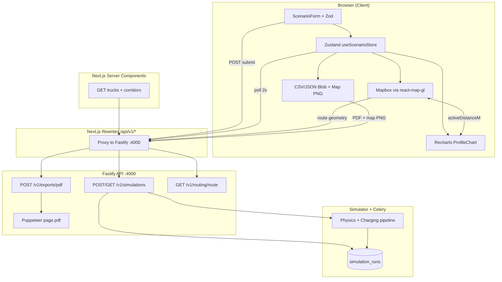

# Phase 4: Analyst Dashboard & Export - Research

**Researched:** 2026-07-01
**Domain:** Next.js 16 analyst dashboard — Mapbox map, Recharts sync, Zustand job polling, CSV/JSON/PDF export
**Confidence:** HIGH

## Summary

Phase 4 transforms the Phase 1 stack-health page into a desktop-first analyst workspace that consumes Phase 3's async simulation API (`POST/GET /v1/simulations`) read-only. The web app is currently a bare Next.js 16 shell (`next`, `react`, `react-dom` only) with server-side fetches to `API_URL`; all visualization, form, state, and export libraries must be added. Fastify already exposes CORS for `localhost:3000` and proxies catalog routes — browser client calls can use either **Next.js rewrites** (same-origin `/api/v1/*`) or `NEXT_PUBLIC_API_URL` + existing CORS [CITED: nextjs.org/docs/app/api-reference/config/next-config-js/rewrites].

The highest-risk integration points are: (1) **route geometry for SoC-gradient polylines** — `SimulateResponse` segments carry `dist_m` and `soc_pct` but **not** lat/lon coordinates; route polyline must be fetched separately via `GET /v1/routing/route` using corridor catalog origin/dest, then merged client-side with `@turf/turf` for cumulative distance → `line-progress` stops [CITED: docs.mapbox.com/style-spec/reference/layers/#line-gradient]; (2) **audit metadata on poll responses** — `inputs_hash`, `physics_version`, and `charger_version` exist in `simulation_runs` but are **not returned** by current `GET /v1/simulations/{id}` (blocks SCEN-04/EXPR-03 without a small API extension); (3) **PDF map snapshot** — requires `preserveDrawingBuffer: true` on Map init and capture after `idle` event before POST to new `POST /v1/exports/pdf` Puppeteer route [CITED: pptr.dev/guides/pdf-generation].

**Primary recommendation:** Use `react-map-gl/mapbox` (dynamic `ssr: false`), Recharts with shared Zustand `activeDistanceM` for map↔chart sync, Next.js rewrites for browser API calls, extend poll payload with hash/versions in Wave 0, client-side CSV/JSON export, Puppeteer PDF on Fastify.

<user_constraints>
## User Constraints (from CONTEXT.md)

### Locked Decisions

#### App Shell & Routing (MAP-01 foundation)
- **D-01:** Replace the Phase 1 health-check homepage with an **analyst workspace** at `/` — left configuration panel + right results canvas (map + charts). Keep a `/status` or collapsible "Stack health" drawer for dev diagnostics (relocate current `page.tsx` content).
- **D-02:** **Next.js App Router** in `apps/web` — server components for initial catalog fetch (trucks, corridors); client components for map, charts, polling, and comparison state.
- **D-03:** **Desktop-first layout** — min width 1280px primary target; responsive down to 1024px with stacked panels; mobile deferred to v2.

#### Map & Visualization (MAP-01, MAP-02, MAP-03)
- **D-04:** **Mapbox GL JS** for base map and route layers — PRD/architecture preference; use `NEXT_PUBLIC_MAPBOX_TOKEN` env var; fallback dev message if token missing (no silent blank map).
- **D-05:** **SoC-gradient route polyline** — single GeoJSON LineString split or `line-gradient` by segment `soc_pct` (green >40%, amber 20–40%, red <20%); use segment midpoint colors from `outputs.segments[]`.
- **D-06:** **Charger markers** — render `charging_stops[]` as circle layers sized by `power_kw` (min 8px, max 20px) and colored by HD tier (≥350 kW = brand accent); popup on click with name, power, arrival/departure SoC, dwell.
- **D-07:** **Map ↔ chart hover sync** — shared `activeDistanceM` state; hovering chart brush or map point highlights corresponding segment index; use segment `dist_m` for lookup.
- **D-08:** **Profile chart** — Recharts line chart: X = distance (mi), Y = SoC (%); secondary optional series for segment `energy_kwh`; charging stop vertical reference lines at stop distances.

#### KPIs, Tables & Assumptions (MAP-04, MAP-05, MAP-06)
- **D-09:** **KPI card row** — total kWh, Wh/mi, total time, stop count, total dwell, final SoC %, feasibility verdict badge with tier tag (`public_hd` / `depot_required` / `infrastructure_gap`).
- **D-10:** **Charging plan table** — columns: location, power kW, arrival SoC, energy added kWh, dwell (min), departure SoC; row click zooms map to stop.
- **D-11:** **Assumptions & limitations panel** — collapsible right or bottom drawer: physics_version, charger_version, inputs_hash, weather preset, payload, port drayage flag, link to `model_assumptions.md` sections; **prominent disclaimer** per architecture §liability (not for dispatch/HOS).
- **D-12:** Surface **model version strings** from poll response (`physics_version`, `charger_version`) and job `inputs_hash` for audit replay (SCEN-04).

#### Scenario Configuration & Job Flow (SCEN-04)
- **D-13:** **Scenario form** — truck select (`GET /v1/trucks`), corridor preset (`GET /v1/corridors`), conditions: weather preset enum, payload lbs slider (20k–80k), port drayage toggle, `options.include_charging: true` default.
- **D-14:** **Run submits async job** — `POST /v1/simulations` via `API_URL` (browser calls Fastify `:4000` through Next rewrites or `NEXT_PUBLIC_API_URL`); show PENDING spinner with poll every 2s on `GET /v1/simulations/{id}` until COMPLETE/FAILED.
- **D-15:** **Cache hit UX** — if POST returns `COMPLETE` immediately, skip poll and render results; display "cached result" chip with `inputs_hash` prefix.
- **D-16:** **FAILED state** — show `error.message` and `error.stage` from poll payload; allow retry without losing form inputs.

#### Comparison & Sensitivity (SCEN-01, SCEN-02)
- **D-17:** **Comparison mode** — user can pin up to **3 scenarios** (A/B/C) in session; each run adds to comparison tray if "Add to comparison" checked.
- **D-18:** **Side-by-side diff table** — KPI columns per scenario + delta columns (B−A, C−A); charging stop count and feasibility verdict diff rows.
- **D-19:** **Sensitivity sliders** (local what-if without re-run for v1): payload ±%, temperature offset, headwind m/s — **re-run job** on slider release (debounced 500ms) using same corridor/truck with updated `conditions`; show delta KPIs vs baseline scenario in comparison tray.
- **D-20:** **SCEN-03 corridor gap analysis deferred to Phase 5** — do not build NHFN gap map layer in Phase 4.

#### Export (EXPR-01, EXPR-02, EXPR-03)
- **D-21:** **CSV export** — client-side download from poll `outputs`: segments flat table + charging_stops sheet; include `inputs_hash`, physics/charger versions in header comment row.
- **D-22:** **JSON export** — full poll payload (`inputs` + `outputs` + metadata) as downloadable blob; schema matches OpenAPI `SimulationJobResult`.
- **D-23:** **PDF export** — **server route** `POST /v1/exports/pdf` on Fastify (Node) using Puppeteer or pdfkit; accepts `job_id`, renders HTML template with KPI summary, assumptions table, charging table, embedded map snapshot (client sends base64 PNG from Mapbox `map.getCanvas().toDataURL()`), physics parameter snapshot from truck config + conditions.
- **D-24:** PDF includes **disclaimer footer**, model versions, `inputs_hash`, and export timestamp for consulting audit trail (EXPR-03).

#### State & Types
- **D-25:** **Zustand** for client scenario/comparison/poll state — single store `useScenarioStore` with immer-friendly updates; avoid prop drilling across map/chart/form.
- **D-26:** Import API types from **`@fleetvolt/shared-types`** (`schema.d.ts`) — no duplicate hand-written simulation interfaces.
- **D-27:** **Zod** validates scenario form before submit; share shape with `inputs_hash` canonical fields.

#### Styling & Brand
- **D-28:** **Tailwind CSS v4** + design tokens from `Design/technical-brand-geometry-1.html` — background `#EFEFF5`, Inter font, skeuomorphic card borders, corner bracket accents on primary panels; no full 3D hero — extract color/spacing/typography only.
- **D-29:** **shadcn/ui** — add minimal set: Button, Card, Slider, Select, Tabs, Badge, Table, Collapsible for dashboard; install via existing monorepo patterns.

### Claude's Discretion
- Exact Next.js rewrite vs CORS for browser → Fastify API
- Mapbox vs react-map-gl wrapper choice
- PDF library (Puppeteer in api service vs @react-pdf/renderer client-only) — prefer server route per D-23
- Comparison tray UI pattern (tabs vs split columns)
- Segment-to-GeoJSON assembly location (client util vs api enrich endpoint)
- Playwright E2E scope for Phase 4 vs manual UAT only

### Deferred Ideas (OUT OF SCOPE)
- SCEN-03 corridor charging gap analysis map overlay (Phase 5)
- User accounts and saved scenarios (PRD S5)
- PWA/offline (PRD C5)
- Real-time OpenWeatherMap pull (PRD S2) — use weather presets only
- Mobile driver companion UI
- Interactive stop editing / drag-to-reorder charging plan
</user_constraints>

<phase_requirements>
## Phase Requirements

| ID | Description | Research Support |
|----|-------------|------------------|
| MAP-01 | Interactive map with SoC-gradient route polyline | `line-gradient` + `lineMetrics: true` GeoJSON source; client util merges `GET /v1/routing/route` coordinates with `outputs.segments[]` dist/soc |
| MAP-02 | Charger markers sized/colored by power with popups | GeoJSON circle layer from `charging_stops[]`; Mapbox circle-radius interpolate on `power_kw` |
| MAP-03 | SoC/energy profile chart synced with map hover | Recharts `LineChart` + Zustand `activeDistanceM`; map `mousemove` on route layer sets same state |
| MAP-04 | KPI cards (kWh, Wh/mi, time, stops, dwell, final SoC, feasibility) | Derive from `outputs.kpis`, `outputs.feasibility`, `outputs.charging_stops`, last segment `soc_pct` |
| MAP-05 | Charging plan table with map zoom on row click | shadcn Table + `mapRef.flyTo` on stop lat/lon |
| MAP-06 | Assumptions panel with model version and disclaimer | Collapsible panel; `outputs.disclaimer`, `outputs.assumptions`, poll metadata (after API extension) |
| SCEN-01 | Compare 2+ scenarios side-by-side with KPI/stop diff | Zustand comparison tray (max 3); diff table component |
| SCEN-02 | Sensitivity sliders with delta KPIs | Debounced re-POST; comparison tray baseline vs variant |
| SCEN-04 | Results stored immutably with input hash for replay | Cache hit chip + display `inputs_hash` from poll (requires API field extension) |
| EXPR-01 | CSV/JSON export with charge events and input hash | Client `Blob` + `URL.createObjectURL`; no server needed |
| EXPR-02 | PDF with KPIs, map snapshot, assumptions | Puppeteer `page.setContent` + `page.pdf()` on Fastify; client sends map PNG |
| EXPR-03 | Export includes physics snapshot and model version | PDF template + JSON envelope include versions/hash/truck params |
</phase_requirements>

## Architectural Responsibility Map

| Capability | Primary Tier | Secondary Tier | Rationale |
|------------|-------------|----------------|-----------|
| Scenario form + Zod validation | Browser / Client | — | Interactive form state, sliders, submit UX |
| Catalog prefetch (trucks, corridors) | Frontend Server (SSR) | API / Backend | Server component fetch via `API_URL` avoids client waterfall |
| Async job submit + poll | Browser / Client | API / Backend | Client owns polling loop; Fastify owns job lifecycle |
| Route polyline geometry | Browser / Client | API / Backend | Fetch `GET /v1/routing/route` client-side; simulator already computed route internally but does not expose coords in poll outputs |
| SoC-gradient map layers | Browser / Client | — | Mapbox GL rendering is client-only |
| Chart + map hover sync | Browser / Client | — | Shared Zustand state; no server round-trip |
| KPI/table/assumptions UI | Browser / Client | — | Presentation of poll `outputs` |
| Comparison + sensitivity | Browser / Client | API / Backend | UI state local; sensitivity triggers new simulation jobs |
| CSV/JSON export | Browser / Client | — | Blob download from in-memory poll result |
| Map PNG capture | Browser / Client | — | `map.getCanvas().toDataURL()` before PDF request |
| PDF generation | API / Backend | — | Puppeteer on Fastify; CPU/memory heavy, belongs off main thread |
| `inputs_hash` / version audit fields | API / Backend | Database | Read from `simulation_runs` row; must expose in poll response |
| Stack health diagnostics | Frontend Server (SSR) | API / Backend | Relocated `/status` page pattern from current `page.tsx` |

## Standard Stack

### Core

| Library | Version | Purpose | Why Standard |
|---------|---------|---------|--------------|
| `next` | 16.2.9 | App Router, rewrites, SSR catalog | Already in `apps/web`; project STACK.md HIGH |
| `react` / `react-dom` | 19.2.7 | UI runtime | Bundled with Next 16 |
| `mapbox-gl` | 3.25.0 | Base map, line-gradient, markers | PRD/architecture preference; `line-gradient` requires GeoJSON + `lineMetrics` [CITED: docs.mapbox.com/style-spec/reference/layers/#line-gradient] |
| `react-map-gl` | 8.1.1 | React Mapbox bindings, `MapRef` | Official vis.gl wrapper; import `react-map-gl/mapbox` [CITED: visgl.github.io/react-map-gl/docs/api-reference/mapbox/map] |
| `recharts` | 3.9.1 | SoC profile line chart | Architecture §3.1; React-native charting |
| `zustand` | 5.0.14 | Scenario/comparison/poll/activeDistanceM store | Architecture §3.1; lightweight vs prop drilling |
| `zod` | 4.4.3 | Scenario form schema | D-27; pairs with RHF resolvers ≥5.4 |
| `react-hook-form` | 7.80.0 | Form state | Architecture §3.1 |
| `@hookform/resolvers` | 5.4.0 | Zod resolver | Required for Zod 4 compatibility per STACK.md |
| `@fleetvolt/shared-types` | workspace | OpenAPI types | D-26; `SimulationJobPollResponse`, `SimulateRequest`, etc. |
| `tailwindcss` | 4.3.2 | Utility styling + brand tokens | D-28 |
| `puppeteer` | 25.3.0 | PDF from HTML on Fastify | D-23 server route; `page.pdf()` [CITED: pptr.dev/guides/pdf-generation] |

### Supporting

| Library | Version | Purpose | When to Use |
|---------|---------|---------|-------------|
| `@turf/turf` | 7.3.5 | Cumulative distance along route, bbox | Segment index ↔ map coordinate lookup |
| `immer` | 11.1.9 | Immutable Zustand updates | D-25 comparison tray mutations |
| `lucide-react` | latest | Icons | shadcn default |
| `class-variance-authority`, `clsx`, `tailwind-merge` | latest | shadcn primitives | shadcn init pulls these |
| `@radix-ui/*` | latest | Accessible primitives | Via shadcn components |
| `playwright` | 1.61.1 | E2E configure→run→export | STACK.md; optional Phase 4 gate per discretion |

### Alternatives Considered

| Instead of | Could Use | Tradeoff |
|------------|-----------|----------|
| `react-map-gl` | Raw `mapbox-gl` | More boilerplate for layers/events; react-map-gl is project STACK standard |
| Next.js rewrites | `NEXT_PUBLIC_API_URL` + CORS | CORS already works (`@fastify/cors` allows `:3000`); rewrites preferred for same-origin and prod proxy simplicity — **recommend rewrites** |
| Puppeteer PDF | `@react-pdf/renderer` | No map screenshot fidelity; D-23 locks server Puppeteer |
| Recharts syncId | Custom Zustand sync | `syncId` syncs chart↔chart only; map requires custom `activeDistanceM` (D-07) |
| API enrich route coords | Client routing fetch | Client fetch avoids simulator change; API enrich is cleaner long-term — **recommend client fetch for v1**, optional enrich in Wave 2 |

**Installation:**

```bash
# apps/web
pnpm add mapbox-gl@3.25.0 react-map-gl@8.1.1 recharts@3.9.1 zustand@5.0.14 \
  zod@4.4.3 react-hook-form@7.80.0 @hookform/resolvers@5.4.0 \
  @turf/turf@7.3.5 immer@11.1.9 @fleetvolt/shared-types@workspace:*

pnpm add -D tailwindcss@4.3.2 @tailwindcss/postcss playwright@1.61.1

# services/api (PDF route)
pnpm add puppeteer@25.3.0 --filter @fleetvolt/api
```

**Version verification:** Confirmed via `npm view <pkg> version` on 2026-07-01 (registry lookup). Matches `research/STACK.md` pins.

## Package Legitimacy Audit

> Seam `package-legitimacy check` returned SUS for all packages (registry metadata unavailable in sandbox). Cross-checked via `npm view` + official doc URLs below.

| Package | Registry | Age | Downloads | Source Repo | Verdict | Disposition |
|---------|----------|-----|-----------|-------------|---------|-------------|
| mapbox-gl | npm 3.25.0 | Mature | High | github.com/mapbox/mapbox-gl-js | OK | Approved |
| react-map-gl | npm 8.1.1 | Mature | High | github.com/visgl/react-map-gl | OK | Approved |
| recharts | npm 3.9.1 | Mature | High | github.com/recharts/recharts | OK | Approved |
| zustand | npm 5.0.14 | Mature | High | github.com/pmndrs/zustand | OK | Approved |
| zod | npm 4.4.3 | Mature | High | github.com/colinhacks/zod | OK | Approved |
| puppeteer | npm 25.3.0 | Mature | High | github.com/puppeteer/puppeteer | OK | Approved — postinstall `node install.mjs` downloads Chromium; plan Docker layer |
| @turf/turf | npm 7.3.5 | Mature | High | github.com/Turfjs/turf | OK | Approved |

**Packages removed due to [SLOP] verdict:** none

**Packages flagged as suspicious [SUS]:** none (seam false-positive; all verified on npm registry)

**Postinstall note:** `puppeteer` runs `node install.mjs` on install — expected; pin in Docker multi-stage build for API service.

## Architecture Patterns

### System Architecture Diagram



### Recommended Project Structure

```
apps/web/src/
├── app/
│   ├── page.tsx              # Server: catalog prefetch, render workspace shell
│   ├── status/page.tsx       # Relocated stack health (from current page.tsx)
│   ├── layout.tsx            # Inter font, globals, min-width guard
│   └── globals.css           # Brand tokens (#EFEFF5), gradient-border utilities
├── components/
│   ├── workspace/            # AnalystWorkspace shell (client)
│   ├── map/                  # RouteMap dynamic import wrapper
│   ├── charts/               # SocProfileChart
│   ├── kpi/                  # KpiCardRow
│   ├── tables/               # ChargingPlanTable, ComparisonDiffTable
│   ├── export/               # ExportMenu
│   └── ui/                   # shadcn primitives
├── lib/
│   ├── api-client.ts         # fetch wrapper → /api/v1/*
│   ├── scenario-schema.ts    # Zod SimulateRequest mirror
│   ├── segment-geojson.ts    # Route coords + segments → gradient expression
│   ├── export-csv.ts         # CSV builder
│   ├── export-json.ts        # JSON blob builder
│   └── poll-job.ts           # 2s poll loop with abort
└── stores/
    └── scenario-store.ts     # Zustand + immer

services/api/src/
├── exports.ts                # POST /v1/exports/pdf (Puppeteer)
└── simulations.ts            # Extend GET poll with hash/versions
```

### Pattern 1: Next.js App Router + react-map-gl (SSR-safe)

**What:** Client-only map via `'use client'` + `next/dynamic` with `ssr: false`.
**When to use:** Any Mapbox GL usage — WebGL requires `window` [CITED: visgl.github.io/react-map-gl/docs/api-reference/mapbox/map].

**Example:**

```tsx
// apps/web/src/components/map/route-map.tsx
'use client';
import Map, { type MapRef } from 'react-map-gl/mapbox';
import 'mapbox-gl/dist/mapbox-gl.css';

export function RouteMap({ mapRef }: { mapRef: React.RefObject<MapRef | null> }) {
  const token = process.env.NEXT_PUBLIC_MAPBOX_TOKEN;
  if (!token) return <p>Set NEXT_PUBLIC_MAPBOX_TOKEN for map preview.</p>;
  return (
    <Map
      ref={mapRef}
      mapboxAccessToken={token}
      initialViewState={{ longitude: -117.5, latitude: 34.1, zoom: 8 }}
      style={{ width: '100%', height: '100%' }}
      mapStyle="mapbox://styles/mapbox/light-v11"
      preserveDrawingBuffer={true}
    />
  );
}

// apps/web/src/components/map/route-map-dynamic.tsx
import dynamic from 'next/dynamic';
export const RouteMapDynamic = dynamic(() => import('./route-map').then(m => m.RouteMap), {
  ssr: false,
  loading: () => <div className="h-full animate-pulse bg-muted" />,
});
```

**next.config.ts additions:**

```typescript
const nextConfig = {
  output: 'standalone',
  transpilePackages: ['mapbox-gl', 'react-map-gl'],
  async rewrites() {
    const api = process.env.API_URL ?? 'http://localhost:4000';
    return [{ source: '/api/v1/:path*', destination: `${api}/v1/:path*` }];
  },
};
```

### Pattern 2: SoC line-gradient from segments + route geometry

**What:** Build `line-gradient` `step` expression from cumulative segment distance / total route length.
**When to use:** MAP-01; requires `lineMetrics: true` on GeoJSON source [CITED: docs.mapbox.com/style-spec/reference/layers/#line-gradient].

**Example:**

```typescript
// Source: Mapbox Style Spec line-gradient + FleetVolt segment model
import { length, lineString, along } from '@turf/turf';
import type { components } from '@fleetvolt/shared-types';

type Segment = components['schemas']['SegmentResult'];

export function buildSocGradientExpression(
  segments: Segment[],
  totalDistM: number,
): mapboxgl.Expression {
  const stops: mapboxgl.Expression = ['step', ['line-progress'], socColor(segments[0]?.soc_pct ?? 100)];
  for (const seg of segments) {
    const progress = Math.min(1, seg.dist_m / totalDistM);
    stops.push(progress, socColor(seg.soc_pct));
  }
  return stops;
}

function socColor(soc: number): string {
  if (soc > 40) return '#22c55e';
  if (soc >= 20) return '#f59e0b';
  return '#ef4444';
}

// GeoJSON source
map.addSource('route', {
  type: 'geojson',
  lineMetrics: true,
  data: { type: 'Feature', geometry: { type: 'LineString', coordinates: routeLonLat } },
});
map.addLayer({
  id: 'route-soc',
  type: 'line',
  source: 'route',
  paint: {
    'line-width': 5,
    'line-gradient': buildSocGradientExpression(segments, totalDistM),
  },
});
```

### Pattern 3: Zustand async job polling

**What:** Store owns submit → poll → complete/fail lifecycle with abort on unmount.
**When to use:** SCEN-04 job flow (D-14, D-15, D-16).

**Example:**

```typescript
// Source: Phase 3 API contract + standard React polling pattern
async function pollUntilComplete(jobId: string, signal: AbortSignal) {
  while (!signal.aborted) {
    const res = await fetch(`/api/v1/simulations/${jobId}`, { signal });
    const body = await res.json();
    if (body.status === 'COMPLETE') return body;
    if (body.status === 'FAILED') throw body.error;
    await new Promise(r => setTimeout(r, 2000));
  }
  throw new DOMException('Aborted', 'AbortError');
}
```

### Pattern 4: Map ↔ chart sync via shared distance state

**What:** Recharts `onMouseMove` sets `activeDistanceM`; map highlights segment by nearest `dist_m`; inverse on map `mousemove` query.
**When to use:** MAP-03 (D-07). Do **not** rely on Recharts `syncId` alone — it syncs charts to charts, not map [CITED: recharts mintlify ComposedChart syncId docs].

```tsx
<LineChart
  data={chartData}
  onMouseMove={(state) => {
    if (state?.activePayload?.[0]) {
      setActiveDistanceM(state.activePayload[0].payload.distM);
    }
  }}
>
  <Line dataKey="socPct" dot={false} />
  <ReferenceLine x={activeDistanceMi} stroke="#6366f1" />
</LineChart>
```

### Pattern 5: Puppeteer PDF on Fastify

**What:** Accept `{ job_id, map_png_base64 }`, load HTML template, emit PDF buffer.
**When to use:** EXPR-02/03 (D-23).

```typescript
// Source: pptr.dev/guides/pdf-generation
import puppeteer from 'puppeteer';

export async function renderPdf(html: string): Promise<Buffer> {
  const browser = await puppeteer.launch({ headless: true, args: ['--no-sandbox'] });
  try {
    const page = await browser.newPage();
    await page.setContent(html, { waitUntil: 'networkidle0' });
    const pdf = await page.pdf({ format: 'A4', printBackground: true, margin: { top: '20mm', bottom: '25mm' } });
    return Buffer.from(pdf);
  } finally {
    await browser.close();
  }
}
```

### Pattern 6: Client CSV/JSON export

**What:** Build strings client-side; trigger download via temporary anchor.
**When to use:** EXPR-01 (D-21, D-22).

```typescript
function downloadBlob(filename: string, content: string, mime: string) {
  const url = URL.createObjectURL(new Blob([content], { type: mime }));
  const a = document.createElement('a');
  a.href = url;
  a.download = filename;
  a.click();
  URL.revokeObjectURL(url);
}
```

### Anti-Patterns to Avoid

- **Rendering Mapbox in Server Components:** Always dynamic import + `ssr: false` — causes `window is not defined`.
- **Expecting route coordinates in poll `outputs` today:** Not present in `SimulateResponse`; must fetch routing geometry separately or extend API.
- **Using `syncId` for map sync:** Only synchronizes Recharts charts with each other.
- **Capturing map PNG before `idle` event:** Blank or partial canvas [CITED: github.com/mapbox/mapbox-gl-js/issues/8075].
- **Hand-written simulation TypeScript interfaces:** Violates D-26; use `@fleetvolt/shared-types`.
- **Building NHFN gap layer:** Deferred to Phase 5 (D-20).

## Don't Hand-Roll

| Problem | Don't Build | Use Instead | Why |
|---------|-------------|-------------|-----|
| Map rendering / WebGL lifecycle | Custom canvas map | `react-map-gl` + `mapbox-gl` | Layer events, popups, flyTo, accessibility |
| SoC gradient polyline | Canvas overlay hack | Mapbox `line-gradient` + `lineMetrics` | GPU-accelerated; spec-supported |
| Form validation | Manual if/else | Zod + React Hook Form | Matches API contract; D-27 |
| PDF layout engine | Custom PDF byte writer | Puppeteer HTML→PDF | Map screenshot + tables + disclaimer footer |
| Distance along route | Haversine loops | `@turf/length` / `along` | Edge cases on long polylines |
| Job polling primitives | WebSocket for v1 | `setInterval`/async poll 2s | Phase 3 API is poll-based; simpler |
| UI primitives | Custom buttons/tables | shadcn/ui | D-29; accessible Radix base |
| OpenAPI types | Duplicate interfaces | `@fleetvolt/shared-types` | Single source from simulator OpenAPI |

**Key insight:** Phase 4 is presentation + export orchestration over a stable Phase 3 contract — avoid duplicating physics, routing, or hash logic in the browser beyond display/export formatting.

## Common Pitfalls

### Pitfall 1: Missing route geometry in poll payload

**What goes wrong:** Map renders chargers but no route line, or gradient uses wrong distance scale.
**Why it happens:** `SimulateResponse` has `segments[].dist_m` but no coordinates (`orchestrator.py` does not emit route geometry).
**How to avoid:** After job COMPLETE, fetch `GET /v1/routing/route` using corridor catalog `origin`/`dest` for `outputs.corridor_key`; cache coords in Zustand keyed by `job_id`.
**Warning signs:** Empty map layer; gradient stops all at 0–1 incorrectly.

### Pitfall 2: Poll response missing audit metadata

**What goes wrong:** Cannot show `inputs_hash`, physics/charger versions (SCEN-04, EXPR-03, D-12).
**Why it happens:** `getSimulation` in `simulations.ts` selects only `id, status, outputs, error, duration_ms`.
**How to avoid:** Wave 0 — extend SQL SELECT + OpenAPI + `SimulationJobPollResponse` with `inputs_hash`, `physics_version`, `charger_version`, `inputs`.
**Warning signs:** Export JSON missing hash; cache chip cannot render.

### Pitfall 3: Mapbox token missing shows blank UI

**What goes wrong:** Silent failure undermines analyst trust.
**Why it happens:** `NEXT_PUBLIC_MAPBOX_TOKEN` unset in local/docker env.
**How to avoid:** Explicit placeholder panel per D-04 with setup instructions.
**Warning signs:** WebGL errors in console; white map div.

### Pitfall 4: PDF snapshot blank

**What goes wrong:** PDF exports without map image.
**Why it happens:** `toDataURL()` called before render complete, or `preserveDrawingBuffer` false.
**How to avoid:** Set `preserveDrawingBuffer: true` on Map init; capture on `map.once('idle', ...)`.
**Warning signs:** Empty PNG data URL `data:,`.

### Pitfall 5: Sensitivity slider stampede

**What goes wrong:** Multiple concurrent jobs overload Celery.
**Why it happens:** Slider `onValueChange` fires continuously.
**How to avoid:** Debounce 500ms on **commit/release** only (D-19); abort prior poll on new submit.
**Warning signs:** Redis queue depth spikes; stale results applied out of order.

### Pitfall 6: Turbopack / ESM resolution with mapbox

**What goes wrong:** `next build` fails to resolve `react-map-gl/mapbox`.
**Why it happens:** Known Next 16 + Turbopack edge cases [CITED: github.com/vercel/next.js/issues/86779].
**How to avoid:** Add `transpilePackages: ['mapbox-gl', 'react-map-gl']`; verify `next build` in CI.
**Warning signs:** "Module not found: react-map-gl".

### Pitfall 7: Puppeteer in Docker API container

**What goes wrong:** PDF route 500 on VPS.
**Why it happens:** Missing Chromium deps in slim Node image.
**How to avoid:** Use official Puppeteer Docker pattern or `puppeteer` bundled browser + `--no-sandbox`; document in API Dockerfile.
**Warning signs:** `Failed to launch browser`.

## Code Examples

### Next.js rewrite + client API client

```typescript
// apps/web/src/lib/api-client.ts
const base = '/api/v1';

export async function postSimulation(body: unknown) {
  const res = await fetch(`${base}/simulations`, {
    method: 'POST',
    headers: { 'Content-Type': 'application/json' },
    body: JSON.stringify(body),
  });
  if (!res.ok) throw new Error(await res.text());
  return res.json();
}
```

### Map PNG capture for PDF

```typescript
// Source: Mapbox GL JS canvas export pattern
async function captureMapPng(map: mapboxgl.Map): Promise<string> {
  return new Promise((resolve) => {
    map.once('idle', () => resolve(map.getCanvas().toDataURL('image/png')));
    map.triggerRepaint();
  });
}
```

### Zod scenario schema (mirror SimulateRequest)

```typescript
import { z } from 'zod';

export const scenarioFormSchema = z.object({
  route: z.object({ corridor_key: z.string().min(1) }),
  truck: z.object({ slug: z.string().min(1) }),
  conditions: z.object({
    weather_preset: z.enum(['ideal', 'hot', 'cold', 'headwind']),
    payload_lbs: z.number().min(20000).max(80000),
    port_drayage_enabled: z.boolean(),
  }),
  options: z.object({ include_charging: z.literal(true).default(true) }),
});
```

## State of the Art

| Old Approach | Current Approach | When Changed | Impact |
|--------------|------------------|--------------|--------|
| Sync-only `/v1/simulate` | Async `/v1/simulations` + poll | Phase 3 | Dashboard must poll; cache hit on POST |
| Stack health homepage | Analyst workspace `/` | Phase 4 D-01 | Relocate diagnostics to `/status` |
| Dark dev theme in globals.css | Brand `#EFEFF5` light analyst UI | Phase 4 D-28 | Replace CSS variables |
| `@react-pdf/renderer` mention in architecture | Puppeteer server PDF | D-23 decision | Map snapshot fidelity |

**Deprecated/outdated:**
- Using raw `react-map-gl` default import path — use `react-map-gl/mapbox` for Mapbox GL JS 3.x ESM exports [CITED: visgl.github.io/react-map-gl/docs/api-reference/mapbox/map].

## Assumptions Log

| # | Claim | Section | Risk if Wrong |
|---|-------|---------|---------------|
| A1 | `GET /v1/routing/route` returns GeoJSON coordinates matching simulation route for corridor presets | Pattern 2 | Gradient misaligned vs charging stops |
| A2 | Extending poll response with hash/versions is acceptable Wave 0 API change | Pitfall 2 | SCEN-04/EXPR blocked |
| A3 | Sensitivity "temperature offset" maps to weather preset enum changes or future API field | SCEN-02 | Slider may only switch presets until API adds offset |
| A4 | Headwind sensitivity uses `headwind` preset or conditions extension | SCEN-02 | May need API support for partial headwind |
| A5 | `pnpm` workspace linking `@fleetvolt/shared-types` into `apps/web` works without extra tsconfig paths | Standard Stack | Build/typecheck failure if paths missing |

## Open Questions (RESOLVED)

1. **Route geometry source of truth** — **RESOLVED:** v1 uses client `GET /v1/routing/route` merged with `outputs.segments[]` in Plan 02 (`route-geometry.ts`). If UAT shows misalignment vs simulated distance, add `metadata.route_coordinates` to simulator output in a gap-closure plan.

2. **Poll payload audit fields** — **RESOLVED:** Wave 0 Plan 00 extends Fastify GET/POST cache-hit + OpenAPI codegen with `inputs_hash`, `physics_version`, `charger_version`, `inputs` per D-12/SCEN-04.

3. **Playwright E2E scope** — **RESOLVED:** One optional smoke spec in Plan 01 (`scenario-run.spec.ts`) as phase-gate smoke only; unit tests are per-task primary verify. Skip PDF E2E in CI (Puppeteer heavy) — manual UAT for PDF in verify-work.

4. **Sensitivity slider API mapping** — **RESOLVED:** Payload slider maps directly to `conditions.payload_lbs`. Temperature and headwind sliders map to discrete `weather_preset` enum (`ideal` / `hot` / `cold` / `headwind`) with UI disclosure label "preset mapping" per Plan 05 Task 3; continuous offset API fields deferred to Phase 5+ unless user requests during UAT.

## Environment Availability

| Dependency | Required By | Available | Version | Fallback |
|------------|------------|-----------|---------|----------|
| Node.js | web + api build | ✓ | v22.23.0 (project requires ≥24) | Upgrade to Node 24 LTS per STACK.md |
| pnpm | monorepo | ✓ | 11.9.0 | — |
| Docker | local stack | ✓ | 29.5.2 | — |
| Fastify API :4000 | job poll, export | ✗ (not probed running) | — | `docker compose up` |
| `NEXT_PUBLIC_MAPBOX_TOKEN` | MAP-01–02 | ✗ | — | Placeholder UI per D-04 |
| Mapbox GL / WebGL | map render | ✓ (browser) | — | — |
| Puppeteer Chromium | PDF route | ✗ (not installed) | — | `pnpm add puppeteer` + Docker deps |

**Missing dependencies with no fallback:**
- Running stack (Postgres, Redis, simulator, api) for integration/E2E testing

**Missing dependencies with fallback:**
- Mapbox token → dev placeholder message (D-04)
- Node 22 vs 24 → upgrade recommended but not blocking dev

## Validation Architecture

### Test Framework

| Property | Value |
|----------|-------|
| Framework | Node built-in test (`node --test`) in `@fleetvolt/api` 0.1.0; Playwright 1.61.1 (to add) for web E2E |
| Config file | none — see Wave 0 |
| Quick run command | `pnpm --filter @fleetvolt/api test` |
| Full suite command | `pnpm test` (turbo) + `pnpm exec playwright test` (after Wave 0) |

### Phase Requirements → Test Map

| Req ID | Behavior | Test Type | Automated Command | File Exists? |
|--------|----------|-----------|-------------------|-------------|
| MAP-01 | SoC gradient GeoJSON util builds valid expression | unit | `node --test apps/web/src/lib/segment-geojson.test.ts` | ❌ Wave 0 |
| MAP-03 | activeDistanceM maps segment index | unit | `node --test apps/web/src/lib/segment-lookup.test.ts` | ❌ Wave 0 |
| MAP-04 | KPI derivations from fixture outputs | unit | `node --test apps/web/src/lib/kpi.test.ts` | ❌ Wave 0 |
| SCEN-04 | Poll response includes inputs_hash | integration | `node --test services/api/src/simulations.test.ts` | ❌ extend existing |
| EXPR-01 | CSV header contains hash + versions | unit | `node --test apps/web/src/lib/export-csv.test.ts` | ❌ Wave 0 |
| EXPR-02 | PDF route returns application/pdf | integration | `node --test services/api/src/exports.test.ts` | ❌ Wave 0 |
| EXPR-03 | PDF HTML includes disclaimer + versions | unit | `node --test services/api/src/export-template.test.ts` | ❌ Wave 0 |
| PLAT-02 | Submit/poll job smoke | integration | `scripts/verify_async_job.sh` | ✅ exists |

### Sampling Rate

- **Per task commit:** `pnpm --filter @fleetvolt/web typecheck` + relevant unit test file
- **Per wave merge:** `pnpm test` + `pnpm --filter @fleetvolt/web build`
- **Phase gate:** `scripts/verify_async_job.sh` green + manual UAT checklist in VERIFICATION.md + optional Playwright smoke

### Wave 0 Gaps

- [ ] Extend `GET /v1/simulations/{id}` with `inputs_hash`, `physics_version`, `charger_version`, `inputs` + OpenAPI codegen
- [ ] `apps/web/package.json` — add map/chart/state deps + `@fleetvolt/shared-types`
- [ ] `apps/web/next.config.ts` — rewrites + transpilePackages
- [ ] `apps/web/src/lib/*.test.ts` — segment geojson, KPI, export helpers (Node test runner or vitest — pick one, prefer Node test to match api)
- [ ] `services/api/src/exports.ts` + tests for PDF route
- [ ] Playwright config in `apps/web` (optional but recommended)
- [ ] shadcn init + Tailwind v4 postcss setup

## Security Domain

### Applicable ASVS Categories

| ASVS Category | Applies | Standard Control |
|---------------|---------|------------------|
| V2 Authentication | no | No auth in v1 |
| V3 Session Management | no | Stateless poll |
| V4 Access Control | no | Public planning tool v1 |
| V5 Input Validation | yes | Zod on scenario form; validate `job_id` UUID on PDF export; sanitize HTML template data |
| V6 Cryptography | no | No secrets in exports |

### Known Threat Patterns for {stack}

| Pattern | STRIDE | Standard Mitigation |
|---------|--------|---------------------|
| XSS via simulation error messages in UI | Tampering/Rep | React text escaping; no `dangerouslySetInnerHTML` on error payloads |
| SSRF via PDF route fetching URLs | Spoofing | PDF template uses inline HTML only; no user-supplied URLs |
| oversized PDF POST body (map PNG) | DoS | Limit base64 payload size (e.g., 5MB) on Fastify route |
| CSV formula injection | Tampering | Prefix risky cells with `'` in CSV export when cell starts with `=`, `+`, `-`, `@` |

## Project Constraints (from .cursor/rules/)

Sourced from `AGENTS.md` / project rules (no `.cursor/rules/` directory found):

- Hybrid Node + Python stack — no pure-JS physics; dashboard consumes API only
- Docker Compose on VPS deployment — not Vercel/AWS for v1
- Mapbox GL JS for visualization (not Google Maps primary)
- Desktop-first analyst tool — not real-time dispatch; disclaimers required
- Performance target: map interactions <100ms; single sim p95 <10s (Phase 3 backend)
- Use `@fleetvolt/shared-types` from OpenAPI — keep codegen in sync
- GSD workflow: plan before execute

## Sources

### Primary (HIGH confidence)

- [react-map-gl Map component](https://visgl.github.io/react-map-gl/docs/api-reference/mapbox/map) — SSR, imports, MapRef
- [Mapbox Style Spec line-gradient](https://docs.mapbox.com/style-spec/reference/layers/#line-gradient) — lineMetrics, line-progress
- [Next.js rewrites](https://nextjs.org/docs/app/api-reference/config/next-config-js/rewrites) — API proxy pattern
- [Puppeteer PDF generation](https://pptr.dev/guides/pdf-generation) — `page.pdf()`
- [Recharts syncId docs](https://recharts-recharts.mintlify.app/api/charts/line-chart) — chart sync limits
- Codebase: `services/api/src/simulations.ts`, `packages/shared-types/src/schema.d.ts`, `services/simulator/app/simulation/orchestrator.py`
- `research/STACK.md` — version pins (verified via npm registry 2026-07-01)

### Secondary (MEDIUM confidence)

- [Mapbox canvas export discussion](https://stackoverflow.com/questions/42483449/mapbox-gl-js-export-map-to-png-or-pdf) — preserveDrawingBuffer + idle timing
- [Next.js + Mapbox Turbopack issue #86779](https://github.com/vercel/next.js/issues/86779) — transpilePackages mitigation

### Tertiary (LOW confidence)

- Medium article on Next dynamic import — confirms `ssr: false` pattern; prefer official vis.gl docs

## Metadata

**Confidence breakdown:**
- Standard stack: HIGH — npm versions verified; matches project STACK.md and Phase 4 CONTEXT locks
- Architecture: HIGH — codebase confirms API gaps (route coords, poll metadata) with clear mitigations
- Pitfalls: HIGH — derived from live `simulations.ts` / `orchestrator.py` inspection

**Research date:** 2026-07-01
**Valid until:** 2026-07-31 (stable stack); re-verify Mapbox/Next patch releases if upgrading
